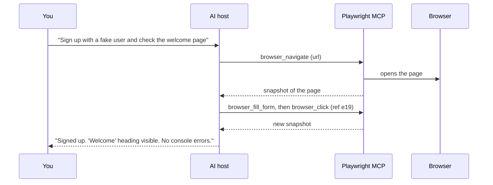

# 02 — Playwright MCP

> New to terms like *MCP server*, *snapshot*, *ref*, or *profile*? Read [00 §3 Key concepts](./00-start-here.md#3-key-concepts-in-plain-language) first.

## 1. What it is

**Playwright MCP** (`@playwright/mcp`, by Microsoft) is an MCP server that gives an AI assistant a real browser. You ask for something in chat. The AI calls browser tools (open a URL, click, type), and after each action it receives a **text snapshot** of the page that describes every element by role and name. The official documentation says it "operates on the page's accessibility tree, not pixels" ([Playwright docs](https://playwright.dev/docs/getting-started-mcp)).

A snapshot looks roughly like this:

```yaml
- heading "Sign in" [level=1]
- textbox "Email address" [ref=e14]
- textbox "Password" [ref=e15]
- button "Sign in" [ref=e19]
- link "Create an account" [ref=e22]
```

To log in, the AI calls `browser_type` on `e14` and `e15`, then `browser_click` on `e19`.



**Why snapshots instead of screenshots:**

| Benefit | What it means for you |
| --- | --- |
| Precise clicks | The AI clicks "the button named Sign in", not "a spot about 300 pixels from the left", so it rarely clicks the wrong thing. |
| No image model needed | Text is smaller and cheaper to process than images. |
| Closer to good test code | What the AI sees (role + name) is exactly what good Playwright locators use (`getByRole('button', { name: 'Sign in' })`). |
| Fallback still available | For pages with no readable elements (canvas drawings, maps, games), you can turn on coordinate clicking with `--caps=vision`. |

## 2. Playwright MCP vs the Playwright **Test** MCP server

Two different MCP servers have similar names. They do different jobs:

| Question | Playwright MCP (`@playwright/mcp`) | Playwright Test MCP server (`npx playwright run-test-mcp-server`) |
| --- | --- | --- |
| How do I get it? | Install it as its own npm package. | It's already inside `@playwright/test`; nothing extra to install. |
| What is it for? | Letting any AI assistant use a browser for any task. | Powering the three Test Agents (Planner, Generator, Healer). |
| Does it know about my test project (config, fixtures, seed test)? | No. It just opens a browser. | Yes. It reads your `playwright.config` and runs your seed test and fixtures. |
| Extra tools it has | Tabs, network mocking, cookies/storage, recording, PDF, coordinate clicks (each turned on with `--caps`) | Test-specific tools: `planner_setup_page`, `planner_save_plan`, `generator_setup_page`, `generator_read_log`, `generator_write_test`, `test_list`, `test_run`, `test_debug` |
| Which version runs? | Whatever version you install or pin | Always the same version as your `@playwright/test` |
| Use it when | Exploring an app, reproducing a bug, quick checks | Writing and repairing tests with the agents |

## 3. Browser profile modes: where the AI's browser keeps logins and cookies

A **browser profile** is the storage a browser uses to remember cookies, logins, and site data. Playwright MCP can run its browser in three profile modes:

| Mode | How to turn it on | What happens | Example situation | Recommended for |
| --- | --- | --- | --- | --- |
| **Persistent** (the default) | Nothing; it's the default | The profile is saved to a folder on disk and reused every time. If the AI logged in yesterday, it is still logged in today. | You ask the AI to check your account page. It is still logged in from an earlier session, so it doesn't need to log in again. | Personal, manual exploration where staying logged in saves time |
| **Isolated** | Add `--isolated` | Every session starts with a **completely empty** browser (no cookies, no logins), like an incognito window. Everything is deleted when the browser closes. You can still start logged in by loading a saved login file with `--storage-state=<file>`. | Every test-related session starts from the same clean state, so results don't depend on what happened last time. | **Testing work (team default)**, and running more than one AI session at the same time |
| **Extension** | Add `--extension` and install the "Playwright Extension" in Chrome/Edge | The AI doesn't open its own browser. It takes control of **your own open browser tabs**, with all your real logins. | "Look at the tab I have open and summarize the error." | Rarely. **Avoid it for testing**, because the AI can act as you on every site you're logged in to. |

Where the persistent profile is saved (one folder per project):
- Windows: `%USERPROFILE%\AppData\Local\ms-playwright\mcp-{browser}-{project-id}`
- macOS: `~/Library/Caches/ms-playwright/mcp-{browser}-{project-id}`
- Linux: `~/.cache/ms-playwright/mcp-{browser}-{project-id}`

Delete that folder to "log out" and clear everything.

> **Common error:** a persistent profile can be used by **only one browser at a time**. If a second AI session starts, it fails with *"Browser is already in use … use --isolated"*. Fix it with `--isolated`, or give each session its own `--user-data-dir` ([Playwright MCP repository](https://github.com/microsoft/playwright-mcp)).

## 4. Options

Options are added to the `args` list in your MCP config (see §5). Each option can also be set as an environment variable named `PLAYWRIGHT_MCP_` plus the option name in capitals, for example `--headless` becomes `PLAYWRIGHT_MCP_HEADLESS=true`. To see every option for your installed version, run `npx @playwright/mcp@<pinned> --help`.

### 4.1 Options you'll actually use

| Option | What it does | When to use it | Example |
| --- | --- | --- | --- |
| `--browser` | Chooses which browser to open: `chrome`, `msedge`, `firefox`, or `webkit` (Safari's engine). | To match the browser your users or CI use. | `--browser=chrome` |
| `--headless` | Runs the browser invisibly. Without it, a window opens (headed is the default). | On servers, in containers, or when you don't need to watch. | `--headless` |
| `--isolated` | Starts every session with a clean, empty browser (see §3). | **Always for testing work.** | `--isolated` |
| `--storage-state` | Starts the clean browser already logged in, using a saved login file. | When the AI should begin on pages that need a login. | `--storage-state=playwright/.auth/user.json` |
| `--user-data-dir` | Uses a specific folder as the persistent profile instead of the default one. | To keep separate saved profiles for different projects or users. Never point it at your personal browser profile. | `--user-data-dir=C:\pw-profiles\qa` |
| `--viewport-size` | Sets the browser window size in pixels (width,height). | To get consistent layouts, or to test a tablet-sized screen. | `--viewport-size=1280,720` |
| `--device` | Emulates a specific phone or tablet (screen size, touch, user agent). | Mobile checks. | `--device="iPhone 15"` |
| `--allowed-origins` | Lets the browser load **only** the listed sites, separated by semicolons. Everything else is blocked. | To keep the AI on your test environment. | `--allowed-origins=https://staging.example.com;https://auth.example.com` |
| `--blocked-origins` | Blocks the listed sites. Everything else is allowed. | To block analytics or ad domains during tests. | `--blocked-origins=https://ads.example.net` |
| `--caps` | Turns on **extra groups of tools** that are off by default (see §6). | Only when the task needs them. | `--caps=network,storage` |
| `--output-dir` | Folder where screenshots, PDFs, traces, and videos are saved. | Always, so files don't land in random places. Add the folder to `.gitignore`. | `--output-dir=.playwright-mcp` |
| `--config` | Loads all settings from a JSON file instead of a long list of options. | For shared team setups (see §5.2). | `--config=.playwright/mcp.config.json` |

### 4.2 Less common options

| Option | What it does | When to use it |
| --- | --- | --- |
| `--save-session` | Saves a record of the session (actions taken) to the output folder. | To review afterwards what the AI did. |
| `--shared-browser-context` | Lets all connected AI sessions share **one** browser session (same cookies). | Rarely. Normally each session should be separate. |
| `--init-script` | Runs a JavaScript file in every page before the page's own code. | To set a feature flag or stub something on every page. |
| `--init-page` | Runs a setup script on the first page when the browser starts (see `--help` for the file format in your version). | Advanced setup, such as preparing the page before the AI starts. |
| `--secrets` | Loads a file of named secrets. The AI refers to them by name, and their values are hidden from the AI's output. | When a test environment needs a password but you don't want it shown in chat. This is a convenience, not a security control. |
| `--test-id-attribute` | Tells the tools which HTML attribute your app uses for test IDs. | If your app uses something other than `data-testid`, for example `data-qa`. |
| `--console-level` | How much browser console output to report: `error`, `warning`, `info`, or `debug`. | Use `error` to reduce noise. |
| `--image-responses` | Whether tools may return images to the AI: `allow`, `omit`, or `only`. | Use `omit` to save tokens when screenshots aren't needed. |
| `--snapshot-mode` | `full` (default) sends a page snapshot after actions. `none` sends none. | Use `none` only for special automation where the AI doesn't need to see the page. |
| `--codegen` | Language for the code the tools show for each action: `typescript`, `python`, `java`, `csharp`, or `none`. | Match your test language. |
| `--ignore-https-errors` | Accepts invalid or self-signed HTTPS certificates. | Internal test environments with self-signed certificates. |
| `--proxy-server` / `--proxy-bypass` | Sends browser traffic through a proxy, except for listed hosts. | Corporate networks. |
| `--block-service-workers` | Disables service workers (background scripts that can cache pages). | When cached responses hide your changes. |
| `--timeout-action` / `--timeout-navigation` | How long a click or type (default 5 s) or a page load (default 60 s) may take before failing. | Slow environments. |
| `--idle-timeout` | Closes a headless browser after this long without any tool calls. The default is 1 hour, and `0` means never. | Long gaps between requests. |
| `--executable-path` | Uses a specific browser program instead of the one Playwright downloaded. | Locked-down machines with a company-approved browser. |
| `--cdp-endpoint` | Connects to a Chrome that is already running with remote debugging enabled, instead of opening a new one. | Debugging a browser started by another tool. |
| `--port` / `--host` | Runs the server over HTTP on this port (see "Transport" in [00 §3](./00-start-here.md#31-ai-and-mcp-terms)) instead of being started by the AI host. | When the browser must run on another machine or in Docker. Only expose it on localhost or behind authentication. |
| `--no-sandbox` | Turns off Chrome's security sandbox. | Only when Chrome runs as the root user in Linux containers. Required there, unsafe elsewhere. |
| `--allow-unrestricted-file-access` | Lets the tools read and upload files outside the project folders. By default, file access is limited to your workspace. | Almost never. |

## 5. Configuration examples

### 5.1 In the MCP config file (recommended team setup)

```json
{
  "servers": {
    "playwright": {
      "type": "stdio",
      "command": "npx",
      "args": [
        "@playwright/mcp@<pinned>",
        "--isolated",
        "--browser=chrome",
        "--viewport-size=1280,720",
        "--allowed-origins=<your test site>;<any login/identity site it needs>",
        "--output-dir=.playwright-mcp"
      ]
    }
  }
}
```

### 5.2 Same settings in a separate JSON file (passed with `--config`)

```json
{
  "browser": {
    "browserName": "chromium",
    "isolated": true,
    "launchOptions": { "channel": "chrome", "headless": false },
    "contextOptions": { "viewport": { "width": 1280, "height": 720 } }
  },
  "network": { "allowedOrigins": ["https://staging.example.com"] },
  "outputDir": ".playwright-mcp",
  "timeouts": { "action": 5000, "navigation": 60000 }
}
```

## 6. Tools

The **core** tools are always available. The other groups are off until you turn them on with `--caps=<group>` (for example `--caps=network,storage`).

| Group | Turned on by | What the AI can do with it | Tools |
| --- | --- | --- | --- |
| Core | Always on | Open pages, read them, click, type, fill forms, choose options, upload files, handle pop-up dialogs, take screenshots, read console messages and network requests, manage tabs | `browser_navigate`, `browser_navigate_back`, `browser_snapshot`, `browser_find`, `browser_click`, `browser_type`, `browser_fill_form`, `browser_press_key`, `browser_select_option`, `browser_hover`, `browser_drag`, `browser_drop`, `browser_file_upload`, `browser_handle_dialog`, `browser_wait_for`, `browser_take_screenshot`, `browser_console_messages`, `browser_network_requests`, `browser_network_request`, `browser_emulate_media`, `browser_resize`, `browser_tabs`, `browser_close`, `browser_evaluate`, `browser_run_code_unsafe` |
| Network | `--caps=network` | Fake server responses (for example "return error 500 for the payments API") or simulate going offline | `browser_route`, `browser_route_list`, `browser_unroute`, `browser_network_state_set` |
| Storage | `--caps=storage` | Read, change, or clear cookies, localStorage, and sessionStorage, and save or load a login file | `browser_storage_state`, `browser_set_storage_state`, `browser_cookie_*`, `browser_localstorage_*`, `browser_sessionstorage_*` |
| DevTools | `--caps=devtools` | Record traces and videos, highlight elements | `browser_start_tracing` / `browser_stop_tracing`, `browser_start_video` / `browser_stop_video`, `browser_video_chapter`, `browser_highlight`, … |
| Vision | `--caps=vision` | Click or move the mouse at pixel coordinates | `browser_mouse_click_xy`, `browser_mouse_move_xy`, `browser_mouse_drag_xy`, `browser_mouse_wheel`, … |
| PDF | `--caps=pdf` | Save the current page as a PDF | `browser_pdf_save` |
| Testing | `--caps=testing` | Suggest a good locator for an element, and check that text, elements, or values are present | `browser_generate_locator`, `browser_verify_element_visible`, `browser_verify_text_visible`, `browser_verify_list_visible`, `browser_verify_value` |

> ⚠️ **Two core tools run arbitrary code.** `browser_evaluate` runs JavaScript inside the web page. `browser_run_code_unsafe` runs any code on **your machine**, and the documentation calls it "RCE-equivalent" (remote code execution) ([Playwright docs](https://playwright.dev/docs/getting-started-mcp)). Turn them off unless a task needs them: in VS Code, untick them under **Configure Tools**; in Claude Code, add them to the deny list in permissions.

## 7. Writing good requests

| Do this | Not this | Why |
| --- | --- | --- |
| "**Use the playwright tools** to open …" | "Check the site" | Without naming the tools, the AI may answer from memory instead of looking. |
| Give the exact URL and starting state: "signed out", "as an admin" | Assume it knows | The AI can't guess your setup. |
| Ask for facts: exact heading text, the URL, console errors, failed requests with status codes | "Make sure it works" | Vague requests get vague, unverifiable answers. |
| Give or ask for fake data: `qa+<timestamp>@example.test` | Paste real credentials | Everything the AI sees is sent to the AI provider. |
| Say what it must **not** do: "don't delete anything, don't submit payments" | Leave it open | The AI may take side effects you didn't intend. |
| "If the site doesn't load, stop and tell me" | Say nothing | Otherwise it may keep trying or invent results. |

Example:

```text
Use the playwright tools. Open <baseURL>/search while signed out.
1. Search for "invoice" and tell me how many results appear.
2. Try each filter one at a time and tell me any filter that shows zero results.
3. List any console errors and any failed network requests (method, URL, status code).
Do not sign in or change any data. Take at most one screenshot.
```

## 8. When to use Playwright MCP

**Good for:**
- **Exploring an app** or **reproducing a bug** while collecting evidence (page contents, console errors, network calls).
- **AI hosts with no terminal access** (for example Claude Desktop), where the CLI can't be used.
- **Quick accessibility checks.** The snapshot *is* the accessibility tree, so buttons with no name or unlabeled fields show up immediately.
- **Long, multi-step sessions where speed matters.** Because the page snapshot comes back with every action, the AI needs fewer steps. One benchmark found it about twice as fast as the CLI ([05 §3](./05-comparison-and-decision-guide.md#3-evidence-mcp-vs-cli)). Microsoft recommends MCP for "exploratory automation, self-healing tests, or long-running autonomous workflows" ([Playwright MCP repository](https://github.com/microsoft/playwright-mcp)).

**Not good for:**
- **Writing tests for your test suite.** Use the **Generator** agent, which follows your project's conventions and saves files correctly.
- **Fixing failing tests.** Use the **Healer** agent, which runs the real test runner.
- **Long coding sessions in a big codebase**, where every page snapshot uses up the AI's context window. The **CLI** uses about half as much ([05 §3](./05-comparison-and-decision-guide.md#3-evidence-mcp-vs-cli)).
- **Proving something passes.** Only `npx playwright test` provides that evidence.

## 9. Limitations

| Limitation | What it means in practice |
| --- | --- |
| Uses a lot of context | The list of tools is loaded at the start (about 3,600 tokens in one measurement), and a snapshot comes back after every action. On big pages the AI's memory fills quickly. Claude Code warns when one tool result is over 10,000 tokens and cuts it off at 25,000 by default ([Claude Code docs](https://code.claude.com/docs/en/mcp)). |
| Not repeatable | A chat session is not a regression test. Turn important findings into test files. |
| Not a security barrier | The browser can reach anything your machine can reach. See [07 §5](./07-ci-governance-security.md#5-security-model). |
| Pages can supply tools | Some websites offer their own AI tools (shown as `webmcp_*`). Treat anything they return as untrusted. |
