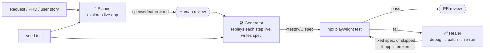

# 04 — Playwright Test Agents: Planner, Generator, Healer

Introduced in Playwright **1.56** and renamed "test agents" in 1.56.1. The agents are agent definitions, meaning "collections of instructions and MCP tools", backed by the test MCP server ([docs](https://playwright.dev/docs/test-agents)). They can run on their own, one after another, or chained in a loop.

## 1. Overview



| | 🧭 **Planner** | 🛠 **Generator** | 🩹 **Healer** |
| --- | --- | --- | --- |
| Its job | Opens your app, clicks through it, and writes a **test plan**: a Markdown document listing test scenarios, their steps, and the expected results | Takes one scenario from the plan, **performs each step in a real browser** to make sure it works, then writes a Playwright test file | Runs a failing test, looks at the page at the moment it failed, works out why, changes the test, and runs it again until it passes |
| What you give it | A request ("plan tests for the checkout page"), the seed test, and optionally a requirements document | A scenario from a plan in `specs/` | The name or file of the failing test, plus its error output |
| What you get back | A plan file, for example `specs/checkout.md` | A test file in your test folder, normally one file per scenario | A fixed test that passes. If it decides the **app** (not the test) is broken, it marks the test as skipped and explains why. |
| Main tools (explained in the next table) | `planner_setup_page`, browser tools, `planner_save_plan` | `generator_setup_page`, browser tools, `browser_verify_*`, `generator_read_log`, `generator_write_test` | `test_list`, `test_run`, `test_debug`, `browser_snapshot`, `browser_generate_locator`, console/network tools, file editing |
| Files it may change | Only the plan file | Only the new test file | The failing test file |

### What each agent tool does

These tools come from the Playwright Test MCP server. The agent files list which agent may use which tool.

| Tool | Used by | What it does |
| --- | --- | --- |
| `planner_setup_page` | Planner | Runs your seed test and opens a browser in the resulting state, ready to explore |
| `planner_save_plan` | Planner | Saves the finished plan as a Markdown file in `specs/` |
| `generator_setup_page` | Generator | Like `planner_setup_page`, but prepares the browser for generating one specific test |
| `generator_read_log` | Generator | Returns a log of every action the Generator performed in the browser, with the locators it used. The test code is written from this log. |
| `generator_write_test` | Generator | Saves the generated test file to disk |
| `test_list` | Healer | Lists the tests in your project, like `npx playwright test --list` |
| `test_run` | Healer | Runs one or more tests and returns pass/fail and error output |
| `test_debug` | Healer | Runs a failing test and **pauses at the failure**, so the Healer can inspect the page at that moment |
| `browser_snapshot` | All | Returns the current page as an accessibility snapshot (elements with roles, names, and refs) |
| `browser_click`, `browser_type`, `browser_navigate`, … | Planner, Generator | Perform actions in the browser |
| `browser_verify_element_visible`, `browser_verify_text_visible`, `browser_verify_list_visible`, `browser_verify_value` | Generator | Check that an element, some text, a list, or a field value is present. Each check becomes an assertion in the test. |
| `browser_generate_locator` | Healer | Suggests a robust locator for an element, for example to replace one that stopped working |
| `browser_console_messages`, `browser_network_requests` | Planner, Healer | Show browser console errors and the network calls the page made, which helps find the cause of a failure |
| `search`, `edit` | Generator, Healer | The AI host's own tools for searching and editing files in your project |

Default folder layout ([docs](https://playwright.dev/docs/test-agents)):

```text
.github/agents/          # agent definitions (VS Code/Copilot); .claude/agents/ for Claude Code
specs/                   # human-readable plans
<tests>/seed.spec.<ext>  # seed
<tests>/…                # generated tests
playwright.config.<ext>
```

## 2. The seed test

When the Planner or Generator starts, it runs the seed test first (through `planner_setup_page` or `generator_setup_page`) and then continues in the browser the seed left open. Because the seed is a normal Playwright test, everything your tests normally get is applied: fixtures (for example a logged-in user), `beforeEach` hooks, global setup scripts, and any setup projects your config defines. The Generator also copies the seed's style (imports, fixtures) into the tests it writes.

| Rule | Why it matters | Example |
| --- | --- | --- |
| Keep the seed short and make sure it always passes | If the seed fails, the agents can't start | Only `page.goto('/')` plus a login |
| Use the same fixtures your real tests use | The agents then see the app in the same state your tests will | Use your `loggedInPage` fixture instead of typing a password in the seed |
| Create one seed per starting state if you need several | Each plan section names its seed in a `Seed:` line, so different sections can start differently | `seed.guest.spec.ts` (logged out), `seed.admin.spec.ts` (admin user) |
| Don't import the seed into other tests | It's a starting point for the agents, not shared setup. Shared setup belongs in fixtures. | — |
| Decide whether the seed should also run with your normal tests | If the seed file is inside `testDir`, `npx playwright test` and CI run it like any other test | Keep it as a cheap smoke test, or place it outside `testDir` |

## 3. Anatomy of an agent definition

VS Code/Copilot format (`.github/agents/<name>.agent.md`), using fields from the [VS Code reference](https://code.visualstudio.com/docs/agents/reference/custom-agent-file-reference):

```markdown
---
name: playwright-test-generator
description: Use this agent when you need to create automated browser tests using Playwright
tools:
  - search
  - playwright-test/browser_click
  - playwright-test/generator_setup_page
  - playwright-test/generator_write_test
  # …
model: <model name>            # optional; string or ordered fallback array
mcp-servers:                   # used by Copilot *cloud* agent; ignored by VS Code locally
  playwright-test:
    type: stdio
    command: npx
    args: [playwright, run-test-mcp-server]
    tools: ["*"]
---
<system prompt: workflow + rules>

<!-- Add a clearly delimited block for YOUR project's conventions -->
## Project context
- Language/extension, test folder, fixture module, page objects, data rules, forbidden actions…
```

| Field | Notes |
| --- | --- |
| `tools` | The list of tools this agent is **allowed** to use. Anything not listed is blocked. The part before `/` (here `playwright-test`) must be exactly the server name used in your MCP config file, otherwise the agent can't find the tools. Writing `playwright-test/*` allows every tool from that server. |
| `model` | Which AI model the agent uses. Optional: leave it out and the agent uses whatever model is selected in the chat. You can list several, and the first one available is used. |
| `mcp-servers` | Tells the **GitHub Copilot coding agent** (the version of Copilot that runs on GitHub's servers and opens pull requests by itself) how to start the MCP server. VS Code on your computer ignores this field and reads `.vscode/mcp.json` instead. |
| `handoffs` | Optional. Adds buttons after the agent's answer that switch to another agent with a ready-made request, for example a "Generate tests from this plan" button that opens the Generator. |

The prompt body is where **your project rules** go. The generated defaults are generic.

## 4. 🧭 Planner

**What it does, step by step:**
1. Runs the seed and opens the browser (`planner_setup_page`).
2. Clicks through the app, reading each page as a text snapshot. It takes screenshots only when necessary.
3. Works out the main user journeys, for example "search, then open a result, then add it to the cart".
4. Writes scenarios of three kinds: **happy path** (normal use works), **edge cases** (limits such as empty input or very long text), and **negative cases** (wrong input shows an error, or access is refused).
5. Saves the plan to `specs/` (`planner_save_plan`).

**Prompt template:**

```text
Create a test plan for <feature/area> at <baseURL><path>.
Starting state: <signed out | signed in as role X via seed Y>.
Cover: happy paths, validation/error handling, permissions/guest restrictions, boundaries.
Out of scope: <payments, destructive admin actions, third-party widgets…>.
Do not assert values from external/volatile sources (<e.g. live prices, weather>).
Save to specs/<feature>.md with Seed: <tests>/seed.spec.<ext>. Do not write tests.
```

**Good plan scenario format:**

```markdown
### 2. Search
**Seed:** `tests/seed.spec.ts`

#### 2.1 Search narrows the result list
**Starting state:** signed out, fresh browser.
**Steps:**
1. Open `/search`; confirm the "Search" heading is visible.
2. Type "invoice" in the search box.
**Expected:** only results containing "invoice" are listed; count > 0.
**Failure if:** unrelated results remain, or the empty state appears.
```

**Review before generating:**
- [ ] Coverage matches the request (add a coverage matrix for large areas)
- [ ] Each scenario is independent with its own starting state
- [ ] Expected results are user-observable (text, URL, role), not implementation details
- [ ] Negative cases present
- [ ] Assumptions labelled, then confirmed or removed
- [ ] No real data, no out-of-scope flows

## 5. 🛠 Generator

**What it does, step by step:**
1. Opens the browser in the seed's state (`generator_setup_page`).
2. **Performs each step of the scenario in the real browser**, and checks each expected result with a `browser_verify_*` tool. If a step can't be done, for example because the button doesn't exist, it finds out now instead of writing a broken test.
3. Reads the log of what it did (`generator_read_log`). The log contains the exact locators that worked.
4. Writes the test file from that log (`generator_write_test`).

This "do it first, then write it" approach is the difference from simply asking an AI to "write a test", which often produces locators for buttons that don't exist.

**Rules to write into the Generator's agent file.** The generated file doesn't know your project's conventions, so add your own rules:

| Topic | What to decide | Example rule you might write |
| --- | --- | --- |
| Language | TypeScript or JavaScript | "Write TypeScript files ending in `.spec.ts`." |
| File location and name | Where new tests go and how they're named | "Save as `tests/<suite-name>/<scenario-name>.spec.ts`, lower-case with hyphens." |
| File structure | How a file is organized | "One test per file, inside `test.describe('<suite name>')`. Test title = scenario title. A comment with the step text before each step." |
| Imports | Where `test` and `expect` come from | "Import `test` and `expect` from `tests/fixtures.ts`, not from `@playwright/test`." (Needed if you have custom fixtures.) |
| Page objects | Whether to reuse existing page classes | "Use the classes in `tests/pages/` when one exists. Only add a method if other tests will need it too." |
| Logging in | How a test gets a logged-in user | "Use the `loggedInPage` fixture. Login tests create their own user with the `testUser` fixture." |
| Test data | What data tests may use | "Generate unique fake data per run, for example `qa+${Date.now()}@example.test`." |
| Not allowed | Things the Generator must never do | "Never import the seed file, change application code or config, use fixed waits (`waitForTimeout`), or check values that change on their own (prices, dates)." |

**Prompt template:**

```text
Generate the test for one plan scenario.
- Plan: specs/<feature>.md   - Suite: <exact suite heading>   - Scenario: <exact title>
- File: <tests>/<suite-kebab>/<scenario-kebab>.spec.<ext>   - Seed: <tests>/seed.spec.<ext>
- Steps and expected results: <paste verbatim>
```

Then run it yourself:

```powershell
npx playwright test <tests>/<suite-kebab>/<scenario-kebab>.spec.<ext>
npx playwright test <tests>/<suite-kebab> --repeat-each=5
```

The docs warn that generated tests may have initial errors, and that the Healer can fix those ([docs](https://playwright.dev/docs/test-agents)).

**Tips:**
- **One scenario per request.** You get smaller diffs and less drift from conventions.
- If the plan is ambiguous, the Generator should stop and ask. Instruct it to.
- Reject CSS/XPath/`nth-child` locators in review. Expect `getByRole`, `getByLabel`, `getByText`, `getByTestId`.

## 6. 🩹 Healer

**What it does, step by step:**
1. Runs the tests (`test_run`) to see which fail.
2. Re-runs each failing test in debug mode (`test_debug`), which **pauses at the moment of failure**.
3. Looks at the page as it is at that moment (snapshot), plus console errors, network calls, and the locator that failed.
4. Works out the cause. Typical causes: a button was renamed (locator changed), something loads slowly (timing), test data clashed with another test, or the application changed on purpose.
5. Edits the test and runs it again, repeating until it passes or its rules tell it to stop.
6. If it concludes that the **application itself is broken** (the test is right), it marks the test as skipped with `test.fixme()` and adds a comment explaining what it saw.

**The Healer doesn't ask you questions.** Its default instructions say to "do the most reasonable thing" on its own. That is why you need to write clear limits into its agent file:

- Edit only the failing test (and directly related tests in the same file). Never edit app code, config, or dependencies.
- Never weaken or remove assertions. Never add fixed sleeps or `networkidle`.
- Keep fixtures, page objects, and data setup.
- Report the root cause, the change, and the verification result. Never claim a pass without a run.

**Prompt template:**

```text
Fix the failing test.
- File: <path>   - Title: <exact title>
- Failure output: <error + call log from terminal or HTML report>
```

**Review the Healer's diffs strictly:**

| ✅ Accept | ❌ Reject |
| --- | --- |
| A locator updated to match a renamed button, using `getByRole` | A fixed wait added (`waitForTimeout(3000)`). It hides timing problems and slows every run. |
| A pattern for text that legitimately changes, for example `/\d+ results/` instead of `"12 results"` | An assertion deleted or made weaker, so the test no longer checks what it should |
| A missing `await` added before an assertion | The failing step wrapped in `try/catch`, so errors are silently ignored |
| Test data made unique per run, so tests stop clashing | Timeouts or retry counts raised in the config to make the failure go away |
| `test.fixme()` with a comment and a bug ticket link, for a real application bug | `test.skip()` or `test.fixme()` with no explanation |

**Team policy decision (document it in the Healer file):** whether the Healer may add `test.fixme()`. Recommended: allowed only with a comment describing the observed defect, and the PR must link a bug ticket before merge.

## 7. Chaining

The three agents are designed to be used one after another:

1. **Planner** writes the plan → a person **reviews and commits** it.
2. **Generator** turns each scenario into a test file, one scenario at a time.
3. You run the new tests with `npx playwright test`.
4. **Healer** fixes any that fail → run them again.
5. Open a pull request containing the plan and the tests → a person reviews it ([07 §3](./07-ci-governance-security.md#3-review-checklist-for-ai-generated-tests)).
6. Later: when CI fails after an app change, use the **Healer**. When a new feature arrives, use the **Planner** for just the new part.

> ⚠️ **Run only one Healer at a time.** If several Healers run at the same time against the same Playwright Test MCP server, all but one freeze. The Playwright team says this is "not a supported scenario" ([issue #39235](https://github.com/microsoft/playwright/issues/39235)).

## 8. Upgrading and customizing agents

Re-run `init-agents` **after every Playwright upgrade**. New Playwright versions add or rename agent tools and improve the instructions, and old agent files don't get them ([docs](https://playwright.dev/docs/test-agents)). Because `init-agents` **replaces** the files, follow this procedure:

```powershell
git switch -c chore/regen-playwright-agents
npx playwright init-agents --loop=vscode        # and/or --loop=claude
git diff .github/agents .claude/agents
# re-apply your "Project context" blocks, review tool-list changes, commit
```

- Keep your project rules in **one clearly marked section** at the end of each agent file (for example `## Project context`). After regenerating, you copy that section back in.
- Check the `tools:` list after every regeneration. Remove tools an agent doesn't need. For example, the Planner's list includes `browser_run_code_unsafe`, which can run any code on your machine.
- If the team uses two AI hosts (for example VS Code and Claude Code), each has its own copy of the agent files. Keep the project rules identical in both copies.
- Store reusable prompts (for example `docs/prompts/planner.md`) next to the agents, and keep their paths and extensions consistent with the agent rules. Contradictions are a common cause of drift ([08 §5](./08-troubleshooting-and-known-issues.md#5-instructions-and-settings-that-contradict-each-other)).
