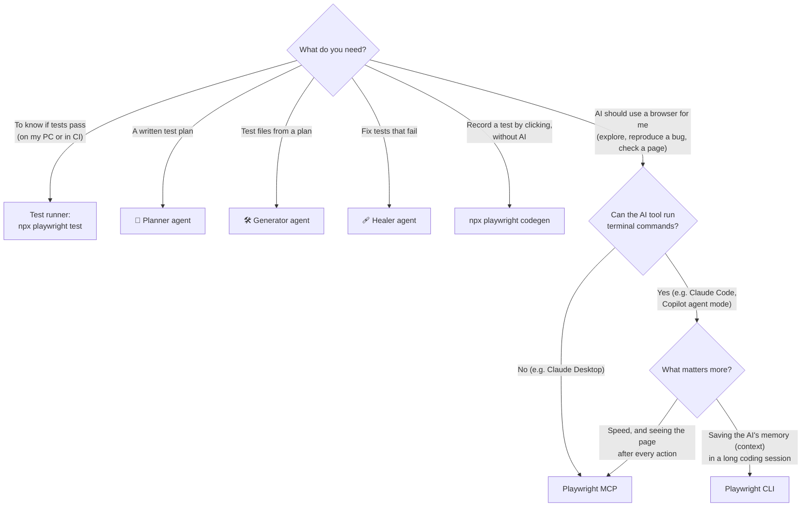

# 05 — Comparison & Decision Guide

This chapter helps you choose the right tool for a task. Each important statement says **where it comes from**, so you can judge how much to trust it:

| Source type | What it means | How much to trust it |
| --- | --- | --- |
| **Official** | Written in Microsoft/Playwright, VS Code, GitHub, or Anthropic documentation | High, for what the tool is designed to do. Officials rarely publish performance numbers. |
| **Measured** | An independent person or company ran a test and published how they did it | Medium. These tests are small (few runs, simple websites), so results may differ on your app. |
| **Claimed** | A blog states a number without showing how it was measured | Low. Don't plan budgets on it. |
| **Our recommendation** | What this team suggests, based on the above | Revisit it when new evidence appears |

## 1. Quick decision guide

The same choices in words:

| If you need to… | Use | Reason |
| --- | --- | --- |
| Find out whether tests pass | **Test runner** (`npx playwright test`) | It is the only tool whose result counts. It runs the same way every time and works in CI. |
| Get a test plan for a feature | **Planner** | It explores the real app and writes a structured, reviewable plan |
| Turn a plan into test files | **Generator** | It tries every step in a real browser before writing it, and follows your project's rules |
| Repair failing tests | **Healer** | It runs the real test, stops at the failure, and inspects the page at that moment |
| Record a test without AI | **`codegen`** | It writes code for exactly what you click. Nothing is guessed. |
| Have an AI explore or check a page, in a tool **without** terminal access | **Playwright MCP** | It is the only option that works without a terminal |
| Have an AI explore or check a page during a **long coding session** | **Playwright CLI** | It uses about half as much of the AI's context, leaving room for your code |
| Have an AI explore or check a page **quickly** | **Playwright MCP** | In the one measured comparison, it finished in about half the time |

## 2. Side-by-side comparison

| Question | Playwright MCP | Playwright CLI | Test Agents | Test runner |
| --- | --- | --- | --- | --- |
| **How does the AI use it?** | It calls browser "tools" through the MCP connection | It types commands into a terminal (`playwright-cli click e15`) | It follows an agent file's instructions and calls Playwright Test MCP server tools | No AI. People and CI run it. |
| **Does the AI tool need terminal access?** | No *(official)* | Yes *(official)* | No. Runs in VS Code, Claude Code, Codex, OpenCode *(official)*. | — |
| **Does it know my project's test setup** (config, fixtures, seed test)? | No. It just opens a browser. | No | **Yes.** It reads `playwright.config` and runs your seed. *(official)* | Yes |
| **How does the AI see the page?** | After every action, the page's text snapshot is sent back to the AI automatically *(official)* | The snapshot is saved to a file. The AI runs another command to read it when needed. *(official)* | Snapshot after each action | — |
| **How much AI memory does it use just by being available?** | The descriptions of all its tools are loaded at the start: about 3,600 tokens in one measurement *(measured)* | Only a short skill description: about 68 tokens in the same measurement *(measured)* | Only the tools listed in that agent's file | None |
| **Visible browser window by default?** | Yes *(official)* | No, add `--headed` *(official)* | Controlled by the test runner | Per your config |
| **Does it remember logins between sessions by default?** | **Yes.** It keeps a saved profile on disk. Use `--isolated` to stop this. *(official)* | **No.** It starts empty each time, unless you use `--persistent`. *(official)* | Starts from your seed test each time | Each test starts empty |
| **Can it write test files?** | No. The AI could write one, but without your project's rules. | It can print code for recorded actions (`recording-start/stop`) *(official)* | **Yes**, following the rules in the agent file | `codegen` records code |
| **Works with GitHub Copilot's cloud coding agent?** | Yes, turned on by default *(official)* | Only if you install it in the setup workflow | Yes, through the agent file's `mcp-servers` section *(official)* | Yes, if installed in the setup workflow |
| **Does the result prove a test passes?** | No | No | Only after you run the test runner | **Yes** |
| **Main risk** | One tool (`browser_run_code_unsafe`) can run any code on your machine, and web pages can try to trick the AI *(official)* | Commands such as `run-code` and `eval` can run any code, and the AI has terminal access | It edits your test files | Low |

## 3. Evidence: MCP vs CLI

### 3.1 What Microsoft says *(official)*

- The CLI is "best for coding agents" because its commands "avoid loading large tool schemas and verbose accessibility trees into the model context" ([CLI docs](https://playwright.dev/docs/getting-started-cli), [MCP repository](https://github.com/microsoft/playwright-mcp)). In plain words: the AI doesn't have to hold the full tool list and every page snapshot in its memory.
- MCP is still recommended for "exploratory automation, self-healing tests, or long-running autonomous workflows" where the AI benefits from seeing the page after every step ([MCP repository](https://github.com/microsoft/playwright-mcp)).
- **Microsoft publishes no speed or token benchmark** for either tool.

### 3.2 What independent tests found

| Who tested | How they tested | AI memory used (tokens) | Time taken | Cost | Did it get the right answer? |
| --- | --- | --- | --- | --- | --- |
| **Ranger** (April 2026, [article](https://outpost.ranger.net/post/the-hidden-cost-of-fewer-tokens/)) *(measured)* | Built the same tool three ways (MCP, CLI, and Vercel's agent-browser). Ran two ~10-step checks on a public website with the Claude Sonnet 4.6 model, and graded the answers with a checklist. They didn't say how many times they ran each. | CLI used about **22,000–24,000**, MCP about **50,000**: the CLI used about **half** | MCP took about **92 and 123 seconds**, the CLI about **240 and 304 seconds**: MCP was about **twice as fast** | About **$0.40 with MCP vs $0.60 with the CLI** on the first check. MCP was slightly cheaper overall. | Practically the same for all three |
| **Better Stack** ([guide](https://betterstack.com/community/guides/ai/playwright-cli-vs-mcp-browser/)) *(measured, one run only)* | Asked Claude Code to do one task on a local web app (open, paste a link, click, wait, screenshot, clear storage, close), once with each tool | CLI **31,000** vs MCP **35,000** in total. At the very start, the CLI used 68 vs MCP's 3,600. | Not measured | Not measured | The CLI finished every step. MCP failed to take the screenshot (timed out). |
| **"114,000 vs 27,000 tokens (4×)"** (for example on [TestCollab](https://testcollab.com/blog/playwright-cli)) *(claimed)* | Said to come from "the Playwright team's own benchmarks", but no link and no method are given | — | — | — | — |

### 3.3 What this means

1. **The CLI does use less of the AI's memory.** Every source agrees. In the only careful test it was about half, not the "4×" that is often quoted. That 4× figure has no published source, so don't plan around it.
2. **Using less memory did not make the CLI faster or cheaper.** In the careful test, the CLI needed about **3× as many steps** (about 40 commands versus 14). Each CLI command returns only "done" or a file name, so the AI must run extra commands to see the page, and those extra steps cost time and money.
3. **Both gave equally correct answers** in the one test that graded accuracy.
4. **The tests were small:** simple public pages, one AI model, few repetitions. Nobody has published results for logged-in, multi-page business apps.

### 3.4 Our recommendation

| Situation | Choose | Why |
| --- | --- | --- |
| A coding agent working in a large codebase for a long session | **CLI** | Running out of AI memory is the bigger problem than a slower browser step |
| A short, interactive investigation where you're waiting for the answer | **MCP** | About twice as fast in the measured test |
| An AI tool without terminal access | **MCP** | The CLI can't be used |
| Writing or fixing tests for the test suite | **Test Agents** | Neither MCP nor the CLI knows your config, fixtures, or rules |
| Before making either the team standard | **Measure on your own app** (§6) | Published tests are too small to rely on |

## 4. Why use the Test Agents for writing tests, rather than "MCP plus a good prompt"?

| Reason | What it means in practice | Source |
| --- | --- | --- |
| They start from your seed test, with your fixtures and setup | The AI sees the app in the same state your tests do: the same logged-in user, the same data | Official ([docs](https://playwright.dev/docs/test-agents)) |
| The Generator tries every step before writing it | Locators and checks have already worked once in a real browser, so fewer tests are broken from the start | Official |
| The Healer uses the real test runner | It fixes the actual failure, not a guess about it | Official |
| Each agent may use only certain tools | The Planner can't write test files, and the Healer can't wander around the app freely, so mistakes stay contained | Official (agent files from `init-agents`) |
| Your rules are stored in files in the repository | Everyone gets the same behavior, and rule changes are reviewed like code | Our recommendation |

**Known limits:**
- Generated tests can still fail at first and may need the Healer *(official)*.
- Running several Healers at once can freeze them ([issue #39235](https://github.com/microsoft/playwright/issues/39235)) *(official)*.
- Results are only as good as the AI model and the rules you write into the agent files *(our recommendation)*.

## 5. Which tool for which situation

| Situation | Use | Why | Don't |
| --- | --- | --- | --- |
| A new feature needs test coverage | Planner → Generator → test runner | You get a plan someone can review, plus tests that follow your rules | Ask a chat with MCP to "write tests" (no rules, nothing verified) |
| Tests fail in CI after a design change | Healer, one test at a time | It debugs at the exact point of failure using the real runner | Fix dozens of files by hand, or run several Healers at once |
| Many tests fail because of the same renamed button | Fix the **page object** once (by hand or with a focused AI request), then the Healer for anything left | One cause, one fix | Let the Healer patch each test file separately |
| A support ticket reports a bug | MCP (in chat) or CLI (in a coding agent) to reproduce it, then Planner + Generator for a permanent test | Evidence first, then a test that stops it coming back | Write the test before you have reproduced the bug |
| "Does my code change show up correctly?" while coding | CLI | Stays inside the coding agent's session | — |
| A free-form exploratory testing session | MCP | The AI sees the page after every step | The Generator (it needs a plan) |
| Check that user A can't see user B's data | CLI with two named sessions (`-s=alice`, `-s=bob`), or MCP with `--isolated` in two chats | Two completely separate browsers side by side | One browser with a saved login |
| Show what happens when an outside service is down | In tests: `page.route()` to fake the failure. While exploring: CLI `route` or MCP with `--caps=network`. | The fake failure is the same every time | Wait for the real service to fail |
| Quick accessibility check | MCP snapshot | The snapshot *is* what screen readers see | Screenshots |
| A video or trace to attach to a pull request | CLI `video-start` / `tracing-start`, or MCP with `--caps=devtools` | Built in | Screen-recording software |
| An area where AI use isn't allowed | `npx playwright codegen` | No AI, and the result is predictable | — |
| A test that fails only sometimes (flaky) | `--repeat-each`, then the trace viewer, then the Healer | Understand the cause before changing anything | Increase the retry count |
| Deciding whether a pull request can be merged | `npx playwright test` in CI | The only real evidence | Trust an AI's statement |

## 6. Run your own comparison (before choosing a team standard)

1. Choose **three typical tasks** from your own app: one simple public page, one task that needs a login, and one long task across several pages.
2. Run each task **five times with MCP and five times with the CLI**, using the same AI model and the same request (change only which tool it should use).
3. For each run, write down how much AI memory was used, how long it took, how many steps the AI made, the cost (from your AI tool's usage report), and whether the answer was right (use a checklist).
4. Pick the tool per type of task. Write the result into this chapter, with the date and the tool versions.
